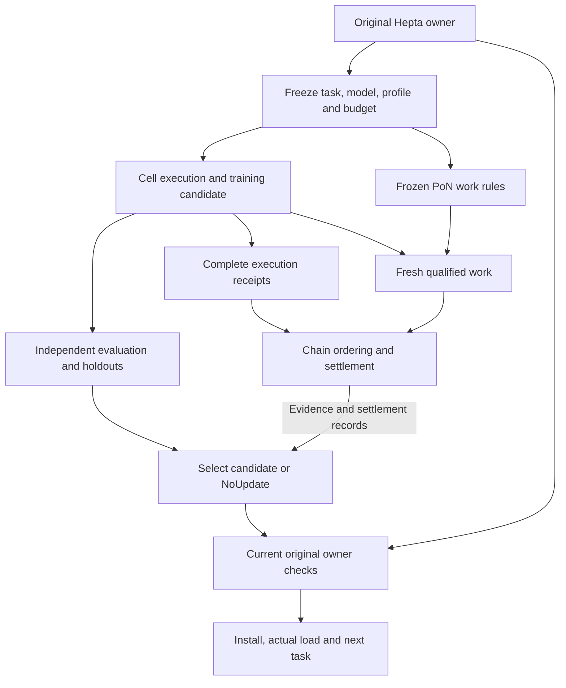

# Original learning iteration to next-use evidence

Status: bounded engineering continuation; **HOLD_NO_GO** for a real, complete
PoN-funded Hepta evolution cycle. This document extends the existing
[native readback review](CELL_ADOPTION_READBACK_V1.md). It does not establish a
new scheduler, training service, model owner, permission issuer or payment owner.

## Source and defect

Chain starts from the original #787 source
`e02126dabef04f13792dec45d96ac5d6916d0651`. Its reader already binds original
native manifests, publications, receipts and next-task observations. However,
those records alone do not carry the complete learning request, frozen budget,
owner roster or preceding learning receipt chain.

The Hepta continuation starts from #5341 at
`f1785ca15e41e4e49509a5b211a659e3cbdbf60e`. The original typed learning request
did not freeze the evaluation profile. Training supplied a profile in its
candidate lineage, and evaluation only had to agree with that returned profile.
The original host contract required independent evaluation, but the coordinator
did not itself reject changing the registered evaluation protocol after training.

[Hepta #5357](https://github.com/TrillionniumFoundation/hepta-private-ci/pull/5357)
adds a mandatory, nonzero `evaluation_profile` to the original request. The
initial checkpoint commits it before the coordinator accepts source work.
Training lineage and both evaluation dispositions must match it. A rejected
training receipt leaves the dataset frontier current and the evaluator is not
dispatched. Recovery compares the whole original request, including this pin.

## Existing owners and the remaining connections

The target integration follows the existing owners below. This is the full
relationship to be completed, not a claim that every edge is exercised by this
increment. Chain evidence informs the selection; current owner authority is
checked again at actual adoption and external effects.



| Boundary | Original owner / contract | This increment | Still required for a real cycle |
| --- | --- | --- | --- |
| Task, model, work and economic terms | `FundedServiceContractV1` in `trnm-protocol` | Preserve its request/model/input/qualified-work/evaluation/fee/dispute commitments | Bind the actual owner-frozen learning request to the original funded Task and current work-rule profile |
| Dispatch and resource reservation | Native Node `NativeTaskOperationBindingV2`, M12 and resource owners | Preserve begin-once, operation identity, version fences and reconciliation | Observe original process/resource identity, complete charges and authoritative terminal outcomes |
| Learning request and progress | `LearningIterationCoordinatorV1` and original protected checkpoint owner | Freeze evaluation profile; replay exact native bounded checkpoint | Complete production `LearningIterationOwnerPortsV1` adapter and independent checkpoint custody |
| Evaluation | Existing `learning.eval` owner | Pin the registered profile, do not infer it from candidate results | Original independent comparisons, holdout protection, retention, interference and total cost |
| Selection or NoUpdate | Existing proposal and selector owners | Bind selected bundle and decision predecessor to exact native first-use records | Authenticated original selection and actor-to-controller association |
| Install, permission and next use | Original generation actor, CURRENT, FinalUse and protected loader | Reuse unchanged original native-use validation | Qualified physical installation, actual neural load and original next-task execution |
| Work ordering and payment | Original consensus and service-settlement owners | No new authority is created by this reader | Same-source confirmation, current canonical anchors, actual payment and reorg reconciliation |

Execution and work may share one task, trace, proof material and intermediate
computation. Their claims remain distinct: a valid execution does not prove a
minimum legal work cost, independent model benefit, payment or current adoption
permission. Reusing material requires exact task, model, input, work-profile,
challenge and output identity at the original owners. This increment does not
invent that missing production bridge or claim it has been exercised.

The learning request's `source_run_id` and `completed_task_receipt` identify the
completed task supplying experience. They must not be relabelled as proof that
the later training/M12 operation ran. The funded-training adapter must retain
both that source provenance and the actual training operation/provider receipt,
with the original contract explaining their relationship.

## Native format and compatibility

The selected native checkpoint uses `HEPLCP02`, with a maximum of 8,192 bytes and
seven receipts. Its request inserts the 32-byte evaluation-profile digest after
`selected_artifact_digest` and before the complete selected bundle. Initial
commitments use `hepta.learning.iteration-checkpoint.v2\0`. Receipt commitments
retain the original `hepta.learning.iteration-observation.v1\0` encoding; their
predecessor commits the initial request.

The independent Python decoder follows original integer widths, byte order,
identifier grammar, optional-field tags, bundle/lineage encoding, owner
separation checks, envelope and resource limits, stage transitions and receipt
digests. It refuses missing/extra/truncated bytes, invalid enums and stale pins.

`HEPLCP01` is explicitly refused. It did not commit an original evaluation
profile. Neither the candidate nor the final evaluation can supply a trusted
missing historical pin. Existing records remain under their original source;
this change neither repairs them in place nor authorizes a new dispatch for an
uncertain old operation.

## Join and independent expectations

`scripts/cell_learning_iteration_join.py` is invoked through the existing
`scripts/cell_adoption_readback.py` CLI. The original v1 readback review still
runs unchanged. The additional join requires all four extra options together:

```sh
python3 -B scripts/cell_adoption_readback.py \
  --readback /absolute/original-readback.json \
  --readback-sha256 "$READBACK_SHA256" \
  --expected /absolute/original-use-expectations.json \
  --expected-sha256 "$USE_EXPECTATIONS_SHA256" \
  --learning-checkpoint /absolute/original-checkpoint.bin \
  --learning-checkpoint-sha256 "$CHECKPOINT_SHA256" \
  --learning-freeze /absolute/original-freeze.json \
  --learning-freeze-sha256 "$FREEZE_SHA256"
```

The freeze file uses `trnm-cell-learning-freeze-expectations-v2`. It contains the
initial head, complete request and original owner roster. The original
supervisor must retain these independently before dispatch. The helper that
extracts such expectations accepts only a zero-receipt initial checkpoint.
Deriving production expectations from a submitted trained candidate would
establish self-consistency only.

The join independently recomputes the initial head and each receipt head. It
requires a pre-NextUse checkpoint whose last receipt is Selection, because that
is the cut exported by the existing generation actor. It then compares:

- Original operation, principal, agent, Cell, source run and completed-task receipt.
- Source artifact and full incumbent bundle, including dependency and lineage commitments.
- Original owner roster, source/envelope pins, frozen profile and resource budgets.
- Dataset and candidate lineage, evaluation, proposal when applicable and selection.
- Exact learning head, selection predecessor, selected bundle and original first-use observation.

A consistent hash relation does not authenticate its issuer or prove when the
freeze was independently retained. The report therefore says
`evaluation_profile_bound_in_initial_checkpoint: true`, while keeping
`pre_dispatch_freeze_authenticated: false`,
`freeze_origin_authenticated: false` and `learning_signatures_verified: false`.
Original native host authentication and receipt-signature verification remain
separate responsibilities.

## NoUpdate and local authority

Both original routes remain valid: the evaluator can return NoUpdate directly,
or a qualified evaluation can be followed by a proposal decision with no
admissible update. The report retains those dispositions separately. Both routes
must select the complete original incumbent, publish the appropriate next-task
owner and use that version under current local authority.

Neither pending output, ACK nor model stop is a completed learning iteration.
This material join still reports `full_learning_iteration_completed: false`.
Only the original learning owner may accept its actual NextUse receipt.

Chain ordering or confirmation does not mint FinalUse. The original owner must
check current authority/revocation, complete version dependencies and local
risk at the actual effect boundary. A reorg cannot erase an external effect or
rewind local revocation and operation history. Unknown outcomes remain Unknown
until authoritative reconciliation; changing a checkpoint version does not
create permission to repeat them. Different nodes can retain different valid
versions under their own current policies.

## Evaluation meaning and evidence boundaries

The profile digest commits a protocol; this reader does not interpret or certify
its scientific content. The existing evaluator must supply no-change,
cell-only, routing-only and joint comparisons, information/resource matching,
retention and interference tests, and protected future/holdout evaluation. A
chain winner or a correctly executed training task may legitimately yield
NoUpdate. Service-payment terms and an improvement bonus remain distinct.

The native fixture export pairs each original readback with the exact production
checkpoint codec output from that actor's coordinator. Retained/adopted cases
each emit pending-output and ACK observations. Those are two engineering cases
at two times, not four independent model experiments. Fixture-derived expected
pins must remain labelled as such, and historical v1 data must not be spliced
into this new-codec corpus.

`scripts/test_cell_learning_iteration_join.py` requires the actual native paired
corpus; absent files fail rather than skip or synthesize successful fixtures.
The evidence index records exact source, command, raw output, byte commitments,
test denominator and observed failures. Independent physical control, real
training/evaluation, protected installation, actual model execution, native
funding/payment and complete product qualification remain **HOLD_NO_GO** until
the corresponding original evidence exists on one reviewed integration source.

## Original contracts

- [Hepta learning.eval technical contract](https://github.com/TrillionniumFoundation/hepta-private-ci/blob/4a93aaf01a594258bcc3e65a1a37ac772675be63/docs/modules/learning.eval/TECHNICAL.md).
- [Native learning request and dispositions](https://github.com/TrillionniumFoundation/hepta-private-ci/blob/4a93aaf01a594258bcc3e65a1a37ac772675be63/codex-rs/hepta-learning-artifacts/src/learning_iteration_types.rs).
- [FundedServiceContractV1](https://github.com/TrillionniumFoundation/Trillionnium-Chain/blob/e02126dabef04f13792dec45d96ac5d6916d0651/trillionnium/crates/trnm-protocol/src/funded_service_task_v1.rs).
- [Original Node task operation owner](https://github.com/TrillionniumFoundation/Trillionnium-Chain/blob/e02126dabef04f13792dec45d96ac5d6916d0651/trillionnium/crates/trnm-pon-node/src/store/task_operation_v2.rs).
